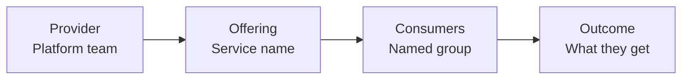
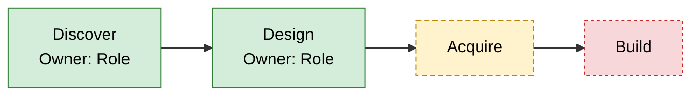
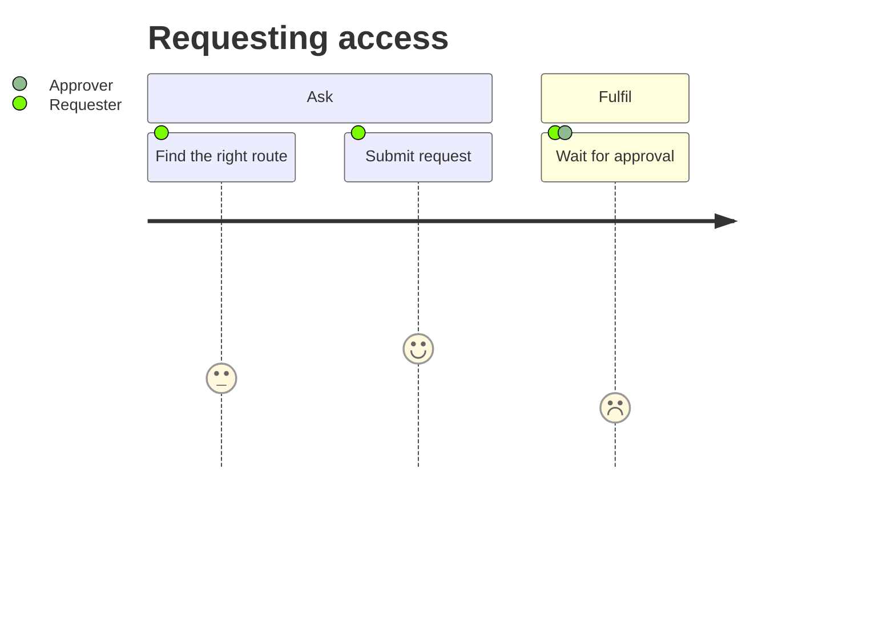

# Diagram standards

All diagrams are **Mermaid** inside Markdown code fences (` ```mermaid `). They render in VS Code (with a Mermaid extension), GitHub, and Confluence with a Mermaid macro.

## The standard set

| # | Diagram | Mermaid type | Shows |
|---|---|---|---|
| D1 | Value proposition | `flowchart LR` | provider → offering → consumer → outcome |
| D2 | Value co-creation | `flowchart LR` with two subgraphs | provider actions, consumer actions, shared moments |
| D3 | Value stream | `flowchart LR` | eight lifecycle activities, with steps, owners and gaps |
| D4 | Architecture and integrations | `flowchart TB` | systems, suppliers, teams and flows between them |
| D5 | Four dimensions | `flowchart TB` or `mindmap` | what sits in each dimension |
| D6 | Consumer journey | `journey` | steps with satisfaction score 1–5 for each actor |
| D7 | Key interaction | `sequenceDiagram` | one important flow, for example request to fulfilment |
| D8 | Outcomes to measures | `flowchart LR` | outcome → measure → target, with missing links shown |

Produce D1 to D6 and D8 every time. Produce D7 for each key flow the source describes in detail (at most three). If the source gives no basis for a diagram, include the heading and a line saying why it was skipped.

## Status styling

Declare these classes once per diagram that needs them and apply them with `:::`.

```
classDef built fill:#d4edda,stroke:#2e7d32,color:#000
classDef proposed fill:#fff3cd,stroke:#b8860b,color:#000,stroke-dasharray:5 3
classDef gap fill:#f8d7da,stroke:#c62828,color:#000,stroke-dasharray:3 3
classDef unconfirmed fill:#e2e3e5,stroke:#6c757d,color:#000,stroke-dasharray:1 3
```

- Built = green solid
- Proposed = amber dashed
- Gap = red dotted
- Unconfirmed = grey dotted

Add a one-line legend under any diagram that uses them: "Green = built · Amber = proposed · Red = gap · Grey = unconfirmed".

For links, use `-->` for working flows, `-.->` for proposed or blocked flows, and put the reason in the label, for example `-.->|"API not built"|`.

## Syntax rules (avoid render errors)

1. Node IDs use letters and digits only, no spaces: `jira`, `snow1`, `stepA`.
2. Put labels in quotes: `jira["Jira (work execution)"]`.
3. Never use the words `end`, `graph` or `subgraph` as IDs or unquoted labels.
4. Do not use `<`, `>`, `{`, `}` or `|` inside labels. Write "and" instead of `&` if it causes problems.
5. Subgraphs need an ID and a quoted title: `subgraph prov["Provider"]` … `end`.
6. Keep each line under about 100 characters; split long labels with `<br/>`.
7. Maximum about 15 nodes per diagram. Split if bigger.
8. In `journey` diagrams, section names and task names have no quotes; score is 1–5; actors are comma-separated: `Request access: 3: Requester, L1 support`.
9. In `sequenceDiagram`, declare participants first with `participant X as "Label"`-style aliases written as `participant X as Label`.
10. Use `flowchart` not the older `graph`.

## Layout guidance

- D3 uses `flowchart LR` with one node per lifecycle activity in order: discover, design, acquire, build, transition, operate, deliver, support. Put owner and system in the node text. Show a feedback link from support back to discover or design, labelled "feedback and improvement".
- D4 groups nodes in subgraphs: consumers, provider teams, systems, suppliers.
- D8 shows each outcome from section 2 once. Use a `gap` node where no measure exists.

## Skeleton examples

D1:



D3 (shortened):



D6:



## Caption pattern

Under each diagram: "**What it shows:** … **What to notice:** …" — one sentence each.
